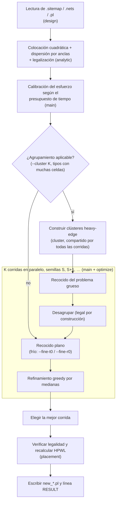

# IE0411 – Placement para FPGA

Placer de línea de comandos en C++17: placement inicial analítico (cuadrático
con dispersión por anclas), *simulated annealing* en dos niveles (primero
sobre *clusters* de celdas muy conectadas, luego sobre la netlist completa a
baja temperatura) con actualización incremental del HPWL, y refinamiento
greedy por medianas. Ejecuta varias corridas independientes en paralelo (una semilla por
corrida) y conserva la mejor.


## Compilación

Requiere `g++` (≥ 7) o `clang++` con soporte de C++17 y `make`.

```bash
make            # genera el ejecutable ./placer
```

## Reproducir los resultados

El `Makefile` compila el placer, lo ejecuta con la configuración por defecto
(presupuesto de tiempo por defecto) y la semilla de la salida entregada, y
verifica el resultado con el evaluador del curso. Se espera la estructura de
la especificación: `benchmarks/FPGAxx/FPGAxx.{sitemap,nets,pl}` y el
`evaluator` en la raíz del proyecto o dentro de `benchmarks/`.

```bash
make results      # todos los benchmarks que haya en benchmarks/ (también FPGA05)
make FPGA01       # un solo benchmark: FPGA00, FPGA01, ..., FPGA05
make evaluate     # sólo verifica los .pl que ya están en outputs/ (sin ejecutar el placer)
make evaluate-FPGA01
```

Cada benchmark escribe `outputs/FPGAxx/new_FPGAxx.pl` (la ruta de la
especificación), la línea `RESULT` en `outputs/FPGAxx/result.txt` y la salida
del evaluador en `outputs/FPGAxx/evaluator.txt`, e imprime si la salida es
legal y su HPWL. **`make results` y `make FPGAxx` sobrescriben las salidas
entregadas en `outputs/`**; para conservarlas, usar otra carpeta con
`OUT_DIR`. Variables que se pueden cambiar:

| Variable | Significado | Valor por defecto |
|---|---|---|
| `BENCH_DIR` | carpeta con los benchmarks | `benchmarks` |
| `OUT_DIR` | carpeta de salida | `outputs` |
| `EVALUATOR` | ruta del evaluador | `./evaluator` o `$(BENCH_DIR)/evaluator` |
| `PLACER_FLAGS` | opciones adicionales para el placer | (ninguna) |
| `SEED_FPGAxx` / `SEED` | semilla base por benchmark / para los demás (FPGA05) | semillas de las salidas entregadas / 1 |

Ejemplo: `make results BENCH_DIR=../benchmarks OUT_DIR=/tmp/salidas`.

Semillas de las salidas entregadas (las del `Makefile`):

| Benchmark | FPGA00 | FPGA01 | FPGA02 | FPGA03 | FPGA04 | FPGA05 |
|---|---|---|---|---|---|---|
| `--seed` | 1 | 17 | 9 | 1 | 5 | 1 |

Tiempos esperados en un i5-9600K de 6 núcleos: FPGA00 ≈ 1 min, FPGA01 ≈ 4 min,
FPGA02 ≈ 10 min, FPGA03 ≈ 1 h 45 min, FPGA04 ≈ 1 h 50 min, FPGA05 hasta 3 h
(tope del presupuesto); todos dentro de su límite.

**Qué se reproduce exactamente.** Con el presupuesto de tiempo (el modo por
defecto), el placer mide la velocidad de la máquina y ajusta el trabajo a
ella (ver *Reproducibilidad*), así que la misma semilla da una salida de la
misma calidad pero no necesariamente idéntica: en otra máquina, o con otra
carga, el HPWL varía dentro de la dispersión entre corridas medida en
*Experimentos* (≈ 0.5–2 % según el benchmark). En FPGA01 las corridas caen en
una de dos cuencas (≈ 342 k o ≈ 357 k), y el mejor de 4 corridas cae en la
buena con probabilidad ≈ 91 %. Para resultados idénticos bit a bit se usa
`--effort` fijo (`PLACER_FLAGS="--effort E"`), que no depende del reloj.

## Ejecución

```bash
./placer <archivo.sitemap> <archivo.nets> <archivo.pl> <salida.pl> [opciones]
```

Ejemplo:

```bash
./placer benchmarks/FPGA01/FPGA01.sitemap benchmarks/FPGA01/FPGA01.nets \
         benchmarks/FPGA01/FPGA01.pl outputs/FPGA01/new_FPGA01.pl
./evaluator benchmarks/FPGA01/FPGA01.sitemap benchmarks/FPGA01/FPGA01.nets \
         benchmarks/FPGA01/FPGA01.pl outputs/FPGA01/new_FPGA01.pl
```

| Opción | Significado | Valor por defecto |
|---|---|---|
| `--seed S` | semilla base; la corrida *i* usa `S+i` | 1 |
| `--runs K` | corridas independientes; se guarda la mejor | nº de núcleos (máx. 4) |
| `--max-runs M` | con presupuesto de tiempo, si el esfuerzo llega a su tope (diseños pequeños), se hacen más tandas de corridas con el tiempo sobrante, hasta M corridas en total; M ≤ K lo desactiva | 64 |
| `--threads T` | hilos de trabajo | `min(runs, núcleos)` |
| `--time-budget S` | tiempo objetivo total en segundos | `min(3 h, 60 + 3.8·10⁻⁷ · N^2.195)`, N = celdas móviles (ver abajo) |
| `--effort E` | esfuerzo fijo del annealing (`inner_num` de VPR); desactiva la calibración y, si no se da `--time-budget`, el límite de tiempo | calibrado |
| `--init MODO` | placement inicial: `qp` (analítico) o `given` (el `.pl` de entrada) | `qp` |
| `--t0-scale F` | T0 = F · σ(ΔHPWL) de movimientos aleatorios | 1 (`qp`), 20 (`given`) |
| `--r0 F` | ventana inicial de movimiento, fracción de la rejilla | 0.05 (`qp`), 1 (`given`) |
| `--qp-iters K` | iteraciones de dispersión del placement analítico | 24 |
| `--qp-growth G` | factor de crecimiento del peso de las anclas | 1.6 |
| `--warm-runs W` | con `--init qp`, las últimas W corridas usan un arranque más caliente (`t0-scale 4`, `r0 0.15`); se ignora si se da `--t0-scale` o `--r0` | 0 |
| `--cluster K` | tamaño máximo de los clusters (bloques de K sitios); 0 = sin clustering | 8 |
| `--coarse-share F` | con presupuesto de tiempo, fracción del tiempo de annealing para la fase de clusters | 0.5 |
| `--coarse-effort E` | esfuerzo de la fase de clusters con `--effort` fijo | igual a `--effort` |
| `--coarse-starts C` | intentos de la fase de clusters por corrida, cada uno con 1/C de su tiempo (o esfuerzo); continúa el mejor (experimental) | 1 |
| `--fine-t0 F`, `--fine-r0 F` | arranque del annealing plano después de deshacer los clusters | 0.3, 0.02 |
| `--fixed-schedule` | con presupuesto de tiempo, mantiene fijos los movimientos por temperatura calibrados (sin re-planificar en cada paso) | re-planificación activa |
| `--window-passes P` | optimización exacta por ventanas después del refinamiento: P pasadas (ver *Algoritmo*); 0 la desactiva | 3 |
| `--window R,C` | ventana de R sitios × C columnas de un mismo tipo (máx. 8 sitios) | 3,2 |
| `--verbose` | muestra el progreso | – |

Al terminar se imprime en `stdout` una línea
`RESULT hpwl=... best_seed=... mean_hpwl=... runs=... effort=... time=...s`.

### Presupuesto de tiempo por defecto

Es una sola ley de potencia en el número de celdas móviles N, ajustada con
`scripts/budget_fit.py` para quedar en el 70 % del límite de tiempo de los
benchmarks cuyo límite es el más restrictivo (FPGA01–03), con un tope de 3 h.
No hay valores por benchmark; FPGA05 recibe el valor de la misma fórmula.

| Benchmark | N | presupuesto | límite |
|---|---|---|---|
| FPGA00 | 245 | 1.0 min | 5 min |
| FPGA01 | 9 470 | 4.4 min | 6 min |
| FPGA02 | 14 634 | 9.8 min | 15 min |
| FPGA03 | 45 537 | 107 min | 150 min |
| FPGA04 | 46 503 | 112 min | 240 min |

El presupuesto se cuenta desde el inicio del programa: la lectura, el
placement analítico y el clustering consumen parte de él, y fuera del
presupuesto sólo quedan la verificación final y la escritura del archivo.
La re-planificación del annealing (ver *Algoritmo*) ajusta el trabajo a la
velocidad medida; en la corrida final (6 núcleos) FPGA02–04 terminaron al
93–95 % de su presupuesto y FPGA01 al 83 %, y con 1–2 hilos (FPGA01/02) al
83–98 %, sin cortes por tiempo (ver *Máquinas con menos núcleos*). Sólo se
ha medido en esta máquina.
Gráfico del ajuste: `budget_fit.png`.

### Reproducibilidad

Con `--effort` fijo, la misma combinación de `--seed`, `--runs` y `--effort`
produce exactamente el mismo placement con el mismo ejecutable, en cualquier
máquina. Otro compilador u otras opciones de compilación pueden cambiar el
redondeo de punto flotante del placement analítico inicial y, con él, el
resultado final (en las pruebas sólo cambió FPGA00, dentro de la variación
entre semillas). Las salidas de `outputs/` se generaron con `bin/placer-v5`,
compilado con `-march=native`; el `Makefile` ya no usa `-march=native` para que
el ejecutable funcione en cualquier procesador x86-64 (misma velocidad medida). En modo
`--time-budget` el esfuerzo se calibra midiendo la velocidad de la máquina y,
además, los movimientos por temperatura se re-planifican durante la corrida a
partir de la velocidad medida, por lo que el resultado depende de la máquina.
El esfuerzo calibrado (`effort=` en la línea `RESULT`) y el efectivo de cada
corrida (`eff.effort ...`) se imprimen; repetir con `--effort` da una corrida
de esfuerzo parecido pero no idéntica, porque con esfuerzo fijo los
movimientos por temperatura no se re-planifican. Si una corrida llega al límite de tiempo antes de terminar el
enfriamiento, se marca como `[deadline hit: not reproducible]`.

### Scripts

```bash
scripts/run_benchmarks.sh <dir_benchmarks> <dir_salida> [opciones]   # tabla HPWL / legalidad / tiempo
scripts/seed_study.sh <dir_benchmark> 5 [opciones]                    # mejor, promedio, desviación, tiempo
scripts/ab.sh <dir_benchmarks> <binario_A> <binario_B> FPGA03,FPGA04 [opciones]  # A/B secuencial con el mismo presupuesto
scripts/budget_fit.py --bench-dir <dir_benchmarks> --sweep sweep.csv  # ajuste del presupuesto por defecto + gráfico
scripts/budget_ab.sh <dir_benchmarks> FPGA03 600 2 salida.csv ./placer "plano:--cluster 0" "s05:--coarse-share 0.5"
                                                                      # configuraciones con igual presupuesto, 1 hilo, CSV
scripts/final_stats.sh <dir_benchmarks> ./placer <dir_salida> 1,5,9,13,17  # estadística de la configuración por defecto
                                                                      # (semillas separadas por el nº de corridas, ver Experimentos)
scripts/window_ab.sh <dir_benchmarks> ./placer FPGA01 1,2,3 3 salida.csv  # ventanas: 0 contra P pasadas, mismo presupuesto
scripts/effort_ab.sh <dir_benchmarks> ./placer FPGA01 5.0,6.2 101,102 salida.csv  # esfuerzo fijo, 1 hilo (no depende de la carga)
python3 -I scripts/make_stress.py <dir_benchmark> FPGA04 stress/S25 --fraction 0.25  # diseño sintético más grande y denso
scripts/stress_test.sh stress ./placer stress.csv S25,S45 --time-budget 1200      # robustez: legalidad, memoria, clustering
```

### Barridos de parámetros (`scripts/sweep.py`, `scripts/summarize.py`)

Cada trabajo es una corrida de un solo hilo con `--effort` fijo, así que el HPWL
es reproducible en cualquier máquina y sólo el tiempo depende del hardware. Los
trabajos corren en paralelo (uno por núcleo) y cada resultado se agrega al CSV
al terminar; un barrido interrumpido se continúa con `--resume`.

```bash
# Plan completo: todos los benchmarks, esfuerzo 0.5–8, 5 semillas
scripts/sweep.py --bench-dir <dir_benchmarks> --dry-run        # lista de trabajos y estimación
scripts/sweep.py --bench-dir <dir_benchmarks> --out sweep.csv
# Los gráficos PNG requieren matplotlib; se instala en un entorno virtual:
python3 -m venv .venv && .venv/bin/pip install matplotlib
.venv/bin/python scripts/summarize.py sweep.csv            # tablas, ajuste tiempo~esfuerzo, "codo", gráficos PNG
.venv/bin/python scripts/summarize.py sweep.csv --markdown # tablas listas para el informe

# Hipótesis de la temperatura inicial (varias configuraciones a la vez)
scripts/sweep.py --bench-dir <dir_benchmarks> --benchmarks FPGA01,FPGA03,FPGA04 \
    --efforts 1 --seeds 5 --config cold: --config "warm:--t0-scale 4 --r0 0.15" \
    --config "given:--init given" --out t0.csv
```

`summarize.py` ajusta `tiempo ≈ a + b·esfuerzo` por benchmark: con eso se
convierte un esfuerzo en presupuesto de tiempo para cualquier máquina (midiendo
`b` en ella). El "codo" es el menor esfuerzo cuyo HPWL promedio queda dentro de
`--tol` (1 %) del mejor promedio. Para medir el tiempo sin competencia entre
procesos, use `--parallel 1`. Si el CSV tiene varias configuraciones, también
compara cada una contra la de referencia (`--ref`, por defecto `cold`) con el
estadístico t de Welch, y estima el HPWL esperado del mejor de K corridas
frente a una sola corrida con K veces el esfuerzo.

## Estructura del código

Dependencias entre módulos (cada uno usa los de su izquierda):
`design` → `placement` → `optimize` / `analytic` → `cluster` → `main`.

| Archivo (`src/`) | Descripción | Usa |
|---|---|---|
| `design.{hpp,cpp}` | Lectura de `.sitemap`, `.nets` y `.pl`; ids enteros, listas red→celdas y celda→redes, índice de sitios por tipo. | — |
| `placement.{hpp,cpp}` | Estado de la colocación: posiciones, ocupación de sitios, cajas de cada red con conteo de bordes, HPWL incremental (`evaluate`/`commit`), verificación de legalidad. | `design` |
| `optimize.{hpp,cpp}` | RNG con semilla, recocido simulado tipo VPR, refinamiento greedy por medianas, medición de la tasa de movimientos. | `placement` |
| `analytic.{hpp,cpp}` | Colocación inicial cuadrática (gradiente conjugado), dispersión por anclas y legalizador. | `placement` |
| `cluster.{hpp,cpp}` | Agrupamiento de celdas (heavy-edge) en bloques verticales, problema grueso y desagrupamiento legal. | `design`, `optimize`, `analytic` |
| `main.cpp` | CLI y flujo completo: carga → analítico → agrupamiento → recocidos en paralelo → refinamiento → verificación → escritura. | todos |

### Flujo de ejecución



Sin agrupamiento (o con `--cluster 0`), cada corrida empieza directamente en el
recocido plano desde la colocación analítica.

## Algoritmo

1. **Lectura y estructuras de datos.** Celdas y nets con identificadores enteros
   y arreglos CSR (net→celdas, celda→nets). Para cada tipo de recurso se guarda
   la lista de columnas y, por columna, las coordenadas *y* ordenadas de sus
   sitios; así un movimiento siempre propone un sitio compatible.
2. **HPWL incremental.** Cada net guarda su caja y cuántas celdas tocan cada
   borde. Mover una celda actualiza la caja en O(1), salvo cuando la única celda
   de un borde se mueve hacia adentro (entonces se recalcula esa net). Los
   movimientos se evalúan sin modificar el estado y sólo se aplican si se
   aceptan. Las nets que contienen a las dos celdas de un intercambio no cambian
   y se omiten.
3. **Placement inicial analítico** (diapositivas del curso, *Algoritmos
   analíticos*). Modelo cuadrático: nets de 2–16 pines como clique con peso
   1/(k−1), nets mayores con un nodo estrella de peso k/(k−1) (mismo óptimo que
   la clique); nets de más de 1000 pines (reloj/reset) se ignoran. Las IO fijas
   son constantes. Se resuelven x e y por separado con gradiente conjugado
   precondicionado (Jacobi). Como la solución colapsa alrededor de las pocas IO,
   se itera al estilo SimPL: legalizar → anclar cada celda a su sitio legal con
   un peso creciente → resolver de nuevo; se conserva el mejor placement legal.
   La legalización asigna a cada celda (en orden de distancia al centroide) el
   sitio libre compatible más cercano, usando arreglos *union-find* de
   "siguiente sitio libre" por columna.
4. **Clustering y annealing en dos niveles** (idea de la colocación guiada por
   clustering; Kahng et al., DAC 2024). Se agrupan celdas del mismo tipo con
   *heavy-edge matching* (Karypis y Kumar): el peso entre dos celdas es
   Σ 1/(|e|−1) sobre las nets que comparten (nets de ≤16 pines), y se unen
   pares repetidamente hasta clusters de ≤K celdas. La parte propia de FPGA:
   un cluster ocupa un **bloque** de K sitios consecutivos de su tipo en una
   columna, así que deshacer el cluster es legal por construcción (sus celdas
   ocupan los K sitios del bloque). El problema reducido es un diseño
   ordinario (celdas = clusters, sitios = centros de bloque), por lo que el
   mismo annealing y legalizador se reutilizan sin cambios. Sólo se agrupan
   tipos con sitios contiguos en la columna y ≥1000 celdas móviles (CLB en
   estos benchmarks); RAM, DSP e IO quedan como celdas individuales. Si un
   diseño no tiene bloques suficientes, K se reduce a la mitad hasta que
   quepa. Flujo: placement analítico → cada cluster en el bloque libre más
   cercano al centroide de sus celdas → annealing de clusters → se deshacen
   → annealing plano frío (T0 = 0.3·σ, ventana 2 %) → refinamiento.
5. **Simulated annealing** con el esquema adaptativo de VPR: temperatura inicial
   20·σ(ΔHPWL) de movimientos aleatorios; `effort·N^(4/3)` movimientos por
   temperatura; factor de enfriamiento según la tasa de aceptación; ventana de
   movimiento que se ajusta para mantener ≈44 % de aceptación (ensanchada por
   tipo para que las columnas dispersas de RAM/DSP sigan siendo alcanzables);
   termina cuando `T < 0.005·HPWL/#nets`, seguido de una pasada greedy.
   Partiendo del placement analítico se arranca "frío" (T0 = 1·σ, ventana
   inicial 5 % de la rejilla) para conservar su estructura global; con
   `--init given` se usa el arranque clásico de VPR (20·σ, ventana completa).
   **Con presupuesto de tiempo**, el esfuerzo inicial sale de una medición
   rápida de la velocidad, y antes de cada temperatura se recalcula el número
   de movimientos: velocidad medida en las últimas 8 temperaturas × tiempo
   restante ÷ temperaturas restantes estimadas (conteo típico medido menos las
   ya hechas). Así el enfriamiento termina cerca del límite aunque la máquina
   sea más lenta o más rápida de lo previsto (p. ej. por otros procesos).
6. **Refinamiento por medianas** (*optimal region*): cada celda se intenta mover
   al sitio compatible más cercano a la región mediana de las cajas de sus nets
   (calculadas sin la celda), aceptando sólo mejoras.
   Después se hace una **optimización exacta por ventanas** (`--window-passes P`,
   3 pasadas por defecto; 0 la desactiva): para cada ventana de R × C sitios
   de un mismo tipo (3 × 2 por defecto, máx. 8 sitios) se prueban todas las
   asignaciones de sus celdas a sus sitios (algoritmo de Heap) y se conserva
   la mejor. Es determinista, sólo acepta mejoras y usa el 5 % del presupuesto
   que se reserva después del annealing, por lo que no le quita tiempo al
   annealing ni puede exceder el presupuesto. En pruebas de una semilla ganó
   0.39 % en FPGA01 con esfuerzo 1 (≈ 6 s por pasada) y 0.11–0.21 % sobre las
   salidas v4 de FPGA03/04 (≈ 26–30 s por pasada). Con el presupuesto por
   defecto en FPGA01 (semillas 1–3, `window_ab_fpga01.csv`) las 3 pasadas
   ganaron en las 3 semillas: media 340 112 contra 342 795 (−0.78 %), con
   14 s más de tiempo (233 s contra 218 s, límite 360 s). Se activó por
   defecto en v6.
7. **Varias corridas** independientes en hilos; se verifica legalidad y HPWL
   completo de la mejor antes de escribir el archivo. Opcionalmente (`--warm-runs W`),
   W corridas pueden usar un arranque más caliente (T0 = 4·σ, ventana 15 %).
   En el barrido sólo mejoró FPGA04 con esfuerzo 1 (−1.6 %); con esfuerzo 2–4
   empata y en los demás benchmarks es igual o peor, por lo que está
   desactivado por defecto.

   **Reinicios en diseños pequeños (v7, `--max-runs`).** Si la calibración
   llega al tope de esfuerzo (30), el diseño no puede usar todo su
   presupuesto: en FPGA00 cada corrida termina en 7 s de 60 s. Ahí más
   esfuerzo no ayuda, pero las corridas caen en cuencas distintas: de 20
   corridas, 5 terminaron en ≈ 10.3–10.6 k y 15 en ≈ 11.4–12.0 k (10 % peor),
   así que el mejor de 4 sólo encuentra la cuenca buena con probabilidad
   1 − 0.75⁴ ≈ 68 %. Por eso, cuando el esfuerzo está en el tope, se lanzan
   más tandas de corridas (semillas S+4, S+5, …) mientras la siguiente quepa
   (1.5 veces la duración de la anterior, dentro del 90 % del presupuesto),
   hasta 64 corridas. Cada corrida usa el esfuerzo fijo del tope, así que es
   determinista; sólo la cantidad de tandas depende de la velocidad de la
   máquina. FPGA01–04 no llegan al tope, así que su comportamiento no cambia.
   Con 4 hilos caben ≈ 28 corridas en FPGA00 (cuenca buena con
   probabilidad ≈ 99.97 %). Las semillas de invocaciones distintas deben
   separarse al menos 64.

## Referencias

- V. Betz y J. Rose, "VPR: A New Packing, Placement and Routing Tool for FPGA
  Research", *FPL*, 1997. (Esquema de annealing y ventana adaptativa.)
- S. Kirkpatrick, C. D. Gelatt y M. P. Vecchi, "Optimization by Simulated
  Annealing", *Science*, 1983.
- K. Shahookar y P. Mazumder, "VLSI Cell Placement Techniques", *ACM Computing
  Surveys*, 1991. (Movimientos a la región óptima / mediana.)
- M.-C. Kim, D.-J. Lee e I. L. Markov, "SimPL: An Effective Placement
  Algorithm", *ICCAD*, 2010. (Dispersión con anclas.)
- A. B. Kahng et al., DAC 2024, doi:10.1145/3649329.3655991. (Colocación
  guiada por clustering.)
- G. Karypis y V. Kumar, "A Fast and High Quality Multilevel Scheme for
  Partitioning Irregular Graphs", *SIAM J. Sci. Comput.*, 1998.
  (*Heavy-edge matching*.)
- S. Goto, "An Efficient Algorithm for the Two-Dimensional Placement Problem
  in Electrical Circuit Layout", *IEEE Trans. Circuits and Systems*, 1981.
  (Región óptima por medianas.)
- D. Blackman y S. Vigna, generador xoshiro256** (dominio público).
- S. Vigna, generador splitmix64 (dominio público), usado para expandir la semilla al estado inicial de xoshiro256**.
- E. Carvajal Barboza, *IE0411 – Diseño Físico Parte 2: Posicionamiento* (presentación del curso).

## Experimentos

### Primeros resultados (máquina de desarrollo, 2 núcleos, 2 corridas en paralelo)

Configuración por defecto (`--time-budget` automático). Todos los resultados
pasan `integrity` y `legality` del evaluador.

| Benchmark | HPWL meta | v1: inicio aleatorio, T0 = 20σ | v2: inicio analítico, T0 = 1σ |
|---|---|---|---|
| FPGA00 | 52 880 | 11 466 (16 s) | 10 398 (10 s) |
| FPGA01 | 1 453 168 | 411 501 (108 s) | 390 763 (125 s) |
| FPGA02 | 2 716 304 | 739 954 (135 s) | 741 909 (168 s) |
| FPGA03 | 11 528 160 | 3 153 244 (386 s) | 2 942 684 (411 s) |
| FPGA04 | 21 846 668 | 5 496 905 (397 s) | 5 535 989 (452 s) |

Observaciones:

- El placement analítico solo (sin annealing) ya obtiene ≈ 1.1 M en FPGA01,
  por debajo de la meta, en < 1 s, pero es ≈ 2.7× peor que el resultado final.
- A esfuerzo fijo (`--effort 1`, 3 semillas) en FPGA01, arrancar del analítico
  con T0 = 1σ y ventana 5 % da 421.9 k promedio en 46 s contra 437.9 k en 58 s
  del arranque aleatorio (−3.7 % HPWL, −20 % tiempo). Con T0 = 2σ el promedio
  empeoró (≈ 442 k).
- Variación entre semillas: ≈ ±4 % (FPGA01), σ/μ ≈ 4–6 % (FPGA00).

### Barridos en una máquina de 6 núcleos (i5-9600K)

Cada trabajo es una corrida de un hilo con `--effort` fijo y 5 semillas
(`scripts/sweep.py`), con 5 trabajos en paralelo; los tiempos incluyen la
competencia entre procesos por memoria, que los hace ≈ 1.5–2× más lentos que
una corrida sola. Todos los resultados pasan `integrity` y `legality`. Datos:
`t0.csv`, `t0_eqtime.csv`, `sweep.csv`; tablas y gráficos con
`.venv/bin/python scripts/summarize.py sweep.csv`.

Utilización de CLB: FPGA00 0.4 %, FPGA01 14.1 %, FPGA02 21.5 %, FPGA03 66.1 %,
FPGA04 67.6 % (FPGA03 y FPGA04 tienen además la misma ocupación de RAM, DSP e IO).

**HPWL promedio vs. esfuerzo** (arranque frío, que es el de por defecto;
tiempo promedio de una corrida):

| Benchmark (límite) | esfuerzo 1 | esfuerzo 2 | esfuerzo 4 | esfuerzo 8 |
|---|---|---|---|---|
| FPGA00 (5 min) | 11 518 (0.3 s) | 10 986 (0.5 s) | 10 716 (1.0 s) | 11 269 (1.9 s) |
| FPGA01 (6 min) | 425 237 (45 s) | 407 033 (90 s) | 388 660 (3.0 min) | 371 177 (6.1 min) |
| FPGA02 (15 min) | 757 327 (103 s) | 737 500 (3.4 min) | 719 579 (6.7 min) | 699 296 (14.2 min) |
| FPGA03 (2 h 30) | 2 939 303 (10.4 min) | 2 902 138 (20.4 min) | 2 874 145 (41 min) | – |
| FPGA04 (4 h) | 5 495 934 (14.8 min) | 5 338 044 (26.2 min) | 5 333 658 (52 min) | – |

Variación entre semillas (σ/μ): 0.5–2.4 % en FPGA01–04. El tiempo crece casi
linealmente con el esfuerzo: ≈ 44, 100, 611 y 768 s por unidad de esfuerzo en
FPGA01–04. FPGA01 y FPGA02 siguen mejorando 2–5 % por cada duplicación del
esfuerzo; FPGA03 ≈ 1 %; FPGA04 deja de mejorar a partir de esfuerzo 2.

**Temperatura inicial (arranque frío vs. tibio).** Se probó si los diseños
densos necesitan un arranque más caliente: frío (T0 = 1σ, ventana 5 %) contra
tibio (T0 = 4σ, ventana 15 %), caliente (8σ, 30 %) y el arranque aleatorio de
VPR (`--init given`). Con esfuerzo 1, el frío fue el mejor en FPGA01–03 (el
tibio fue 4.5–6.4 % peor, estadísticamente significativo con 5 semillas),
mientras que en FPGA04 el tibio fue 1.6 % mejor, incluso a igual tiempo. Como
FPGA03 y FPGA04 tienen la misma utilización, **la hipótesis de que la
temperatura óptima depende de la utilización quedó descartada**. El barrido
completo mostró además que la ventaja en FPGA04 sólo existe con esfuerzo 1:
con esfuerzo 2 y 4 ambos empatan. En FPGA01–03 el tibio es peor con esfuerzo
0.5–2 (hasta +8.7 %) y con esfuerzo 4–8 queda dentro del ruido (−1.4 % a
+0.9 %); en FPGA00 es mucho peor hasta esfuerzo 4 (+19 % a +88 %) y empata
con esfuerzo 8 (−2.8 %). Por eso el arranque frío es el de por defecto
y `--warm-runs` (mezclar corridas tibias entre las paralelas) queda desactivado.

**Varias corridas en paralelo.** En los diseños grandes la variación entre
semillas es pequeña: el mejor de 4 corridas es sólo ≈ 0.5 % mejor que el
promedio en FPGA03–04. Rinde más dar más esfuerzo a cada corrida que agregar
corridas.

**Re-planificación del esfuerzo con presupuesto de tiempo.** En esta máquina,
con 4 hilos, la calibración inicial sobreestimaba la velocidad y todas las
corridas de FPGA03/04 llegaban al límite antes de terminar el enfriamiento (en
la máquina de 2 núcleos ocurría lo contrario: usaban sólo 70–80 % del
presupuesto). Con la re-planificación por temperatura, las corridas terminan
al ≈ 94 % del presupuesto sin cortar el enfriamiento, con HPWL equivalente
(FPGA03 2.951 M vs. 2.942 M; FPGA04 5.433 M vs. 5.428 M; diferencia dentro del
ruido entre semillas).

**Clustering (annealing en dos niveles).** Comparación contra el flujo plano
(sin clusters), todas las salidas legales y sin cortes por tiempo. Datos:
`cluster_*.csv`, `share_default.txt`.

| Prueba | FPGA01 | FPGA02 | FPGA03 | FPGA04 |
|---|---|---|---|---|
| Esfuerzo 1 fijo, 3–5 semillas, K = 8 | −6.5 % | −8.6 % | −2.6 % | −2.2 % |
| Presupuesto de 10 min, 1 hilo, 2 semillas | – | – | −3.8 % | −2.9 % |
| Configuración por defecto completa (corrida final, semilla 1) | −7.1 % | −4.7 % | −3.6 % | −1.3 % |

- **Tamaño de cluster** (FPGA01/02, esfuerzo 1): K = 2, 4, 8 y 16 mejoran
  todos; K = 8 fue el mejor o empatado en ambos.
- **Reparto del tiempo** (`--coarse-share`): con presupuestos cortos importa
  (FPGA03/04 a 10 min: 0.5 fue ≈ 1 % mejor que 0.8; FPGA01 a 60 s fue al
  revés); con 30 min en FPGA03/04 las fracciones 0.5, 0.65 y 0.8 quedan dentro
  del ruido (≤ 0.6 %). Se eligió 0.5, que gana o empata en las configuraciones
  realistas y deja más tiempo al annealing plano.
- Una sola corrida de 30 min con clustering (FPGA03 2.80 M, FPGA04 5.22 M) ya
  supera al flujo plano por defecto (4 corridas, ≈ 100 min: 2.82 M y 5.26 M).

### Resultados finales (configuración por defecto, 6 núcleos)

`scripts/final_stats.sh`, presupuesto de tiempo por defecto, 4 hilos, una
invocación a la vez. Cada experimento es una invocación con una semilla base
distinta; las semillas se separan por el número de corridas para que ninguna
se repita. FPGA01–04 usan `bin/placer-v6` (semillas 1, 5, 9, 13, 17; en FPGA03
y FPGA04 sólo 1 y 5, porque cada invocación tarda ≈ 1 h 45 min) y FPGA00 usa
`bin/placer-v7` (reinicios, 28 corridas por invocación; semillas 1, 65, 129,
193, 257). Datos: `final_v6/stats.csv` y `final_v7_fpga00/stats.csv`. Todas
las salidas pasan `integrity` y `legality` del evaluador y ninguna corrida
llegó al límite de su presupuesto.

| Benchmark | Objetivo HPWL | Límite | Exp. (corridas) | Mejor | Promedio | Desv. est. | Tiempo |
|---|---|---|---|---|---|---|---|
| FPGA00 | 52 880 | 5 min | 5 (140) | **10 275** | 10 354 | 66 (0.6 %) | 48 s |
| FPGA01 | 1 453 168 | 6 min | 5 (20) | **341 585** | 344 862 | 6 847 (2.0 %) | 3.9 min |
| FPGA02 | 2 716 304 | 15 min | 5 (20) | **656 598** | 663 596 | 4 260 (0.6 %) | 9.5 min |
| FPGA03 | 11 528 160 | 2 h 30 | 2 (8) | **2 717 840** | 2 721 292 | 4 881 (0.2 %) | 103 min |
| FPGA04 | 21 846 668 | 4 h | 2 (8) | **5 152 475** | 5 165 074 | 17 818 (0.3 %) | 106 min |

Mejor, promedio y desviación se calculan sobre el mejor resultado de cada
experimento; el tiempo es el promedio por experimento. FPGA01–04 usan entre
44 % y 68 % del límite de tiempo de su benchmark (FPGA00, 16 %). Las salidas
entregadas en `outputs/` son las del mejor experimento de cada benchmark
(semillas en *Reproducir los resultados*).

En FPGA00 las corridas caen en dos cuencas (≈ 10.3–10.6 k y ≈ 11.4–12.0 k);
con 4 corridas por invocación (v6) la desviación entre experimentos era
5.5 % (promedio 10 768), y con los reinicios de v7 todos los experimentos
encuentran la cuenca buena.

Versiones anteriores (una invocación, semilla 1): sin clustering (v4,
`outputs_v4/`) FPGA01 369 584, FPGA02 693 350, FPGA03 2 820 491, FPGA04
5 255 568; con clustering (v5, `outputs_v5/`) 343 305, 660 839, 2 719 649 y
5 186 448; FPGA00 10 359 en ambas.

### Máquinas con menos núcleos

Con `bin/placer-v5` y el presupuesto por defecto en FPGA01/02 (datos:
`threads.csv`). Todas las salidas son legales, ninguna corrida llegó al
límite y todas terminaron dentro del presupuesto (83–98 %). Los trabajos
corrieron a la vez en la misma máquina de 6 núcleos (por la competencia por
memoria, el esfuerzo calibrado es algo menor que en una máquina dedicada).

| Configuración | FPGA01 | FPGA02 |
|---|---|---|
| Por defecto, 6 núcleos (v5: 4 corridas, 4 hilos) | 343 305 | 660 839 |
| 1 núcleo: 1 corrida (lo que el programa elige con 1 núcleo), semillas 1–3 | 345 974 / 365 554 / 357 200 | 665 183 / 660 725 / 666 293 |
| 4 corridas forzadas en 2 hilos | 348 103 | 670 535 |
| 4 corridas forzadas en 1 hilo | 366 653 | 679 626 |

Con un solo núcleo el programa hace una sola corrida con todo el
presupuesto (`--runs` = nº de núcleos, máx. 4). Esa corrida queda cerca del
promedio por corrida de v5 (FPGA01 352 142, FPGA02 666 297): lo que se pierde
es sobre todo el "mejor de 4". Forzar 4 corridas en 1 hilo es peor, porque
cada una recibe un cuarto del tiempo.

### Robustez en diseños más grandes y densos (para FPGA05)

FPGA05 no está disponible, y su objetivo de HPWL (38.9 M, contra 21.8 M de
FPGA04) sugiere un diseño más grande. Para probar el flujo por defecto en ese
caso se generaron diseños sintéticos a partir de FPGA04 con
`scripts/make_stress.py`: se copia una parte conexa de las celdas (búsqueda en
anchura sobre nets de ≤ 16 pines), las nets se copian con sus celdas copiadas,
los IO fijos se comparten y la entrada es un placement aleatorio legal.
`scripts/stress_test.sh` los corre e informa memoria y si el clustering se
desactivó. Presupuesto de 20 min, v6, semilla 1 (`stress.csv`):

| Diseño | Celdas | Uso CLB / DSP | Flujo | HPWL | Tiempo | Memoria | Legal |
|---|---|---|---|---|---|---|---|
| S25 (FPGA04 + 25 %) | 58 148 | 84 % / 99 % | con clustering (7 693 clusters, 8 400 bloques) | 7 012 665 | 1200 s | 146 MB | PASS |
| S45 (FPGA04 + 45 % de CLB) | 66 953 | 98 % / 65 % | plano (hay más clusters que bloques con K = 8, 4 y 2) | 8 225 147 | 1200 s | 168 MB | PASS |

Ambos son legales y sin cortes del annealing por tiempo. Con estos tamaños el
presupuesto por defecto es el tope de 3 h (60 % del límite de FPGA05). Las
corridas terminan justo en el presupuesto porque la optimización por ventanas
se detiene en el límite de cada lote; con el presupuesto por defecto la
reserva posterior al annealing es de unos 9 min y alcanza para las 3 pasadas.
El código no supone una cuadrícula de 168 × 480: todo se lee del `.sitemap`.

## Conservación del mejor estado del annealing

Con `--keep-best`, esta versión conserva el placement de menor HPWL visitado durante cada búsqueda,
incluyendo el placement con el que comienza. Al terminar el enfriamiento, recupera
ese estado antes de la pasada greedy y del refinamiento por medianas.

No cambia las propuestas ni la probabilidad de aceptación del annealing. Lleva
registro de las celdas modificadas desde el último mínimo, y solo copia esas
coordenadas cuando aparece un nuevo mínimo. El espacio adicional es O(celdas).
La restauración reconstruye ocupación y bounding boxes usando `setPositions()`.

La opción es experimental y está desactivada por defecto: activar con `--keep-best`.
Para usar el comportamiento anterior, omitirla o añadir `--no-keep-best`. Con `--verbose` se informa cuando se restaura un estado.

Importante: comenzar el refinamiento desde un mejor estado no garantiza un mejor
resultado final que la versión anterior, porque el refinamiento puede seguir otro
camino. Comparar varias semillas y medir también los tiempos. Esta primera prueba
usa esfuerzo fijo; no sustituye una comparación posterior con igual tiempo total.

Para reproducir la comparación con cinco semillas por benchmark:

```bash
make
python3 tests/compare_best.py --benchmarks /ruta/benchmarks__0411_entrega --effort 0.005
```

El script ejecuta ambas variantes para FPGA00 a FPGA04, verifica cada salida con
el evaluador del curso y guarda CSV, placements y logs en `best_comparison/`.
Requiere Python 3 y el ejecutable `evaluator` en la carpeta de benchmarks.
La carpeta `experiments/best_state/` contiene los resultados de la comparación
realizada al introducir este cambio, y un resumen de sus límites.

Con clustering y esfuerzo 1, en 10 de 10 corridas no restauró ningún estado
(HPWL idéntico; `keepbest.csv`), por lo que queda desactivada por defecto. Solo
ayudó con esfuerzos muy bajos (0.005).
